# ZeroWatch

**AI-based zero-day attack detection for network traffic, shipped as a production-style ML system.**

CSL236 – Introduction to AI and Machine Learning, end-term project · B.Tech CSE (Cybersecurity), Semester 5, The NorthCap University

| | |
|---|---|
| Live deployment | `https://<your-service>.onrender.com` (replace after deploying, see [Deploy](#deploy-render)) |
| API docs | `<live-url>/docs` |
| Repository | https://github.com/ruudrasharma/ZeroWatch |

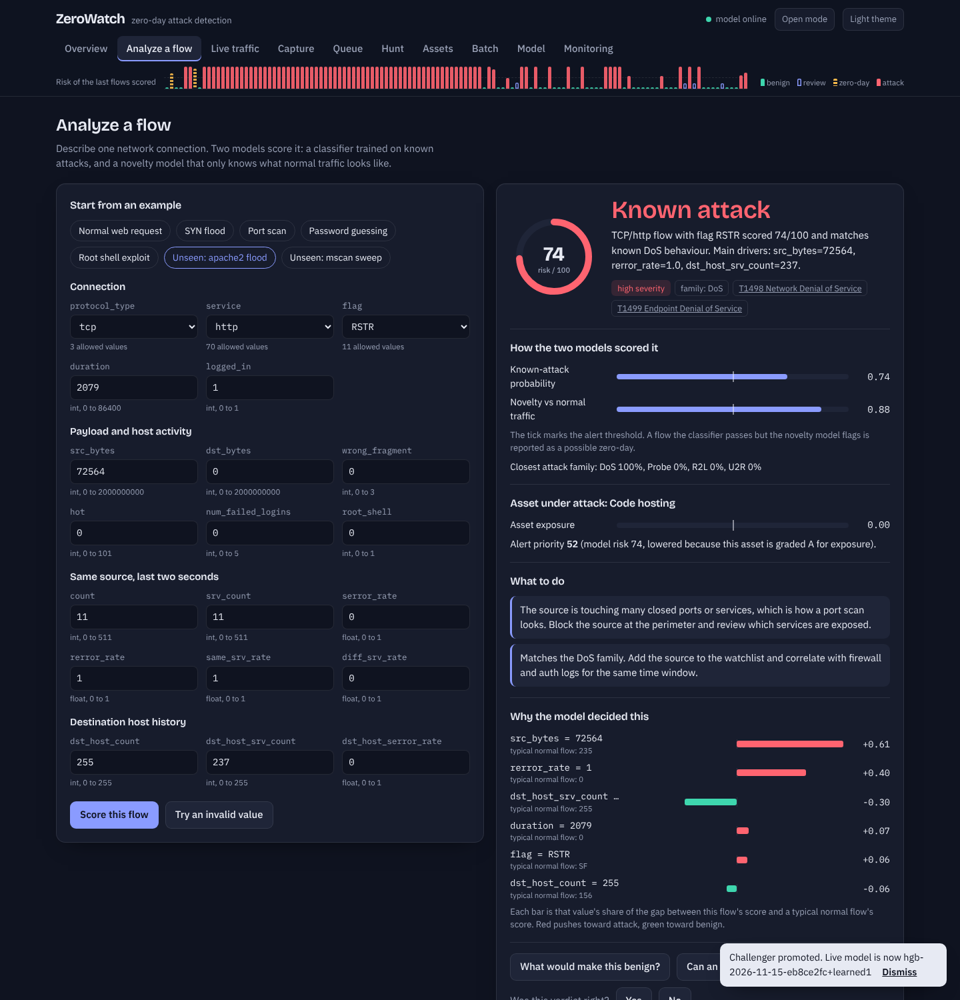

## Problem statement

Signature-based intrusion detection only catches attacks it already has a rule for. ZeroWatch takes one
network connection (a "flow") and answers two questions:

1. **Does it look like a known attack?** A supervised classifier trained on labelled traffic.
2. **Does it look like normal traffic at all?** An Isolation Forest trained on *normal traffic only*. A flow the
   classifier passes but this model flags is reported as a **possible zero-day**.

The graded task is binary classification (`is_attack`: 0 = normal, 1 = attack) on 20 input features and
142,736 rows. On the 3,533 test flows that belong to attack types absent from training, the classifier alone
catches 44.8%; adding the novelty model raises that to 76.7%.

## What makes it different: the zero-day loop

Most intrusion detectors stop at "this looks odd". ZeroWatch closes the loop in the **Hunt** tab:

1. **Detect.** The novelty model flags flows the classifier does not recognise.
2. **Group.** KMeans clusters those flows into campaigns, so 40 alerts become one finding.
3. **Write the rule.** A depth-3 decision tree separates each campaign from normal traffic and its path is
   exported as a readable rule, for example `rerror_rate > 0.38 AND dst_host_count >= 34 AND dst_host_srv_count < 253`,
   with the share of the campaign it covers and the share of normal traffic it would wrongly match.
4. **Learn.** The analyst labels a campaign. A challenger is trained with the live model's settings on the
   training data plus the labelled flows. 30% of the labelled flows are held back, and the challenger replaces
   the live model only if it does better on those and loses no more than 0.002 validation F1.

After promotion the same flow that was a "possible zero-day" is reported as a known attack.

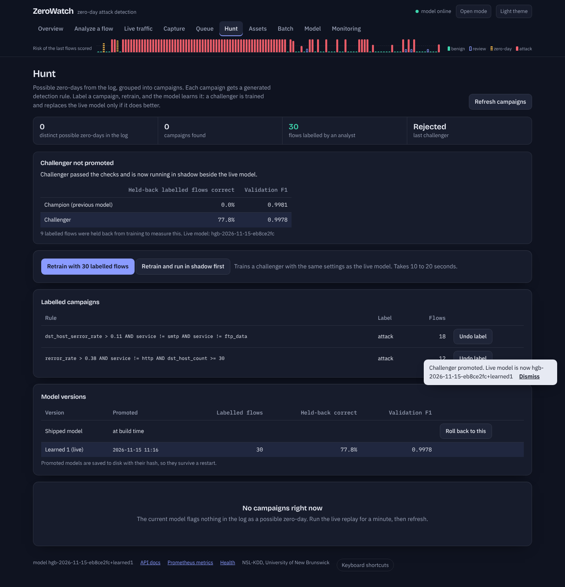

Around the loop:

- **"Not sure" verdict.** Split-conformal calibration on validation data gives a band of attack probabilities
  the model was not calibrated to trust. Flows in it go to review instead of being passed. On KDDTest+ this
  sends 13.4% of flows to review, catches 48.5% of the attacks the classifier would have missed, and accuracy
  on the remaining flows rises from 81.2% to 88.3%.
- **Evasion red-team.** For any flagged flow, a search changes only values an attacker controls (bytes sent,
  duration, connection counts) and reports how few changes slip past detection.
- **Tamper-evident log.** Every logged verdict carries the SHA-256 of the previous line. `/audit/verify`
  recomputes the chain and reports the first edited line.
- **Pipeline security.** `model.joblib` is a pickle, and loading a tampered pickle runs its code, so the app
  checks the file against `model/model.sha256` before loading. Suspicious labels (a "benign" label on a flow
  the model is over 99% sure is an attack) are quarantined before retraining. CI audits dependencies.
- **Shift report.** `/brief` summarises the log into what happened and what to do first.

### Real traffic, a second dataset, assets and a copilot

- **Capture tab: real traffic.** Upload a `.pcap` (up to 5 MB). [`pcap_flows.py`](pcap_flows.py) parses it with the
  standard library, rebuilds TCP/UDP/ICMP connections, derives the connection state from the TCP flags and
  computes the same 20 contract features, so the deployed model scores live packets. A synthetic sample
  capture (web, mail and DNS traffic plus a port scan and a SYN flood) is bundled; on it the model flags all
  60 scan connections and 158 of 160 flood connections, with 7 false alarms in 90 normal connections.
- **Host graph.** Packets carry addresses, which NSL-KDD does not. Each source is judged on all of its flows
  together (distinct ports and hosts, share of failed connections) and labelled scanner, flooder or normal.
  This is graph analytics on the capture, not a trained graph neural network: there is no labelled dataset
  with addresses to train one on.
- **Cross-dataset test.** [`cross_dataset.py`](cross_dataset.py) maps NSL-KDD and UNSW-NB15 onto the six
  measurements they share and trains on one, tests on the other:

  | Trained on | F1 on NSL-KDD | F1 on UNSW-NB15 |
  |---|---|---|
  | NSL-KDD | 0.820 | 0.228 |
  | UNSW-NB15 | 0.162 | 0.909 |
  | Both | 0.810 | 0.908 |

  A detector trained on one network barely works on another (ROC-AUC 0.38 for NSL-KDD → UNSW-NB15, worse than
  guessing), and training on both recovers both. This is the measured reason the retraining loop exists.
- **Assets: recon fused into alerts.** Register an asset with its URL and the services it runs.
  [`recon.py`](recon.py) makes one passive check (HTTPS headers, TLS version and certificate expiry) and scores
  exposure 0–100. Alerts on that asset's services then carry a priority: risk × (0.7 + 0.6 × exposure/100).
  The scan refuses private, loopback, link-local and cloud-metadata addresses, follows no redirects, and is
  limited to 6 per minute per client; set `RECON_ENABLED=0` to switch it off.
- **Copilot.** `/copilot` answers questions about what the service has seen. With `LLM_BASE_URL` set to any
  OpenAI-compatible endpoint (Ollama at `http://localhost:11434/v1`, Groq, OpenRouter) the answer comes from
  that model, grounded in a JSON summary of the log. Without it, or if the model does not answer, built-in
  rules answer the same questions, so it works on a free-tier host.

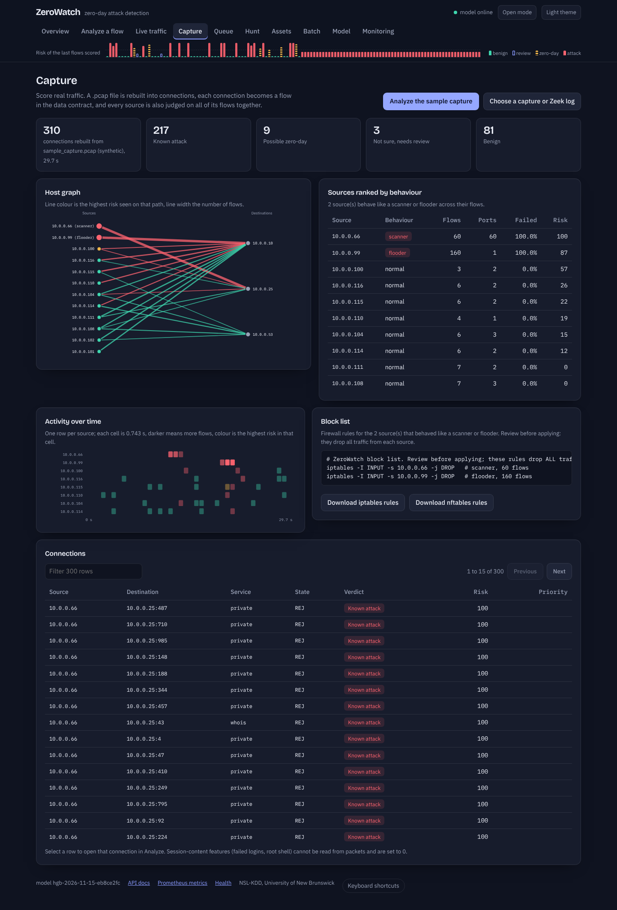

### Operating it safely

- **Roles.** With `ANALYST_TOKEN` and `ADMIN_TOKEN` set, scoring stays open but every route that changes
  state needs an `X-API-Key`: analysts can label, give feedback and triage; admins can also retrain, roll
  back, change the threshold and manage assets. Without the tokens the service runs in open mode and the
  Overview says so. Every such action is written to a second hash-chained log (`/audit/actions`).
- **Strict contract.** The schema is in Pydantic strict mode: `"5"`, `true` and `1000.0` are not integers and
  return 422, as do unknown categories, extra fields and NaN.
- **Log integrity.** [`store.py`](store.py) chains every line to the previous one, keeps an anchor with the
  expected length and head (so cutting lines off the end is detected, not only edits), and rotates the file at
  5 MB without breaking the chain. The head is also on `/health` so an outside monitor can keep its own copy.
- **Model versions.** A promoted challenger is saved to `logs/models/` with its hash, reloaded after a restart,
  and any earlier version can be made live again from Hunt. Only one retrain runs at a time.
- **Alert queue.** Everything not passed as benign, ordered by priority, with a triage state. Closing an alert
  as confirmed or as a false alarm labels the flow, and "No" on the verdict feedback does the same, so analyst
  decisions reach the next retrain.
- **Rules and reports.** Each campaign's rule can be downloaded in Sigma format, tested against the log, and
  packaged with an incident report in Markdown.
- **Threshold.** The Model tab shows catch rate against false alarms for every threshold and lets an admin
  apply one; the change is audited and survives a restart.
- **Alarm.** Every 5 minutes drift and both log chains are checked. When drift appears or a chain breaks, one
  message goes to `ALERT_WEBHOOK_URL` (Slack-style webhook). Replayed and sample traffic is tagged and left out
  of drift, so a demo cannot raise the alarm.
- **Client address.** `X-Forwarded-For` is ignored unless `TRUST_PROXY=1`, and then only its last hop is used,
  so the rate limit cannot be bypassed by sending a fake header.
- **Model pin.** `MODEL_SHA256` in the environment outranks `model/model.sha256`.

- **Shadow mode.** "Retrain and run in shadow first" keeps the live model and lets the challenger score the
  same traffic silently. Hunt shows how often they agree and, for replayed traffic, whether the challenger's
  extra flags are real attacks, before anyone promotes it. `AUTO_RETRAIN=1` starts such a retrain on a timer
  when 50 new labels arrive or drift is detected; an unattended retrain only ever goes to shadow.
- **Named accounts.** `USERS="asha:analyst:<key>,ravi:admin:<key>"` gives each person a key, and the action
  log records the name as well as the role.
- **Read access.** With keys configured, a visitor without one can score flows and watch the replay, but
  cannot read the alert queue, campaigns or action log, upload captures or use the copilot, and the replay
  they watch is not written to the log.
- **Browser hardening.** Content-Security-Policy with scripts from this origin only, HSTS behind the proxy,
  self-hosted fonts and no third-party requests. `DOCS_ENABLED=0` hides `/docs`.
- **Block list and exports.** A capture produces iptables and nftables rules for the sources that scanned or
  flooded. A campaign exports as Sigma, as a STIX 2.1 bundle and as a Markdown incident report.
- **Zeek.** The Capture tab also accepts a Zeek `conn.log` (TSV or JSON), as well as pcap and pcapng.
- **Model tab.** Confusion matrix, attacks caught per family (DoS 95%, Probe 99%, R2L 15%, U2R 42%) and the
  ROC curve, all on held-out KDDTest+.
- **Speed.** Batches, captures and the replay are scored with one model call for all flows: 500 flows take
  about 0.1 s where they took 10 s, and a 3,000-connection capture about 1 s where it took 40 s.

| Variable | Purpose | Default |
|---|---|---|
| `ANALYST_TOKEN`, `ADMIN_TOKEN` | API keys for the two roles | unset (open mode) |
| `USERS` | named accounts, `name:role:key` separated by commas | unset |
| `AUTO_RETRAIN`, `AUTO_RETRAIN_MIN_LABELS` | scheduled retraining into shadow | `0`, `50` |
| `DOCS_ENABLED` | serve `/docs` | `1` |
| `TRUST_PROXY` | believe the last `X-Forwarded-For` hop | `0` |
| `RATE_LIMIT_PER_MIN` | scoring requests per client per minute | `600` |
| `MODEL_SHA256` | expected hash of `model/model.joblib` | from `model.sha256` |
| `ALERT_WEBHOOK_URL`, `ALARM_INTERVAL_SECONDS` | alarm destination and period | unset, `300` |
| `LLM_BASE_URL`, `LLM_MODEL`, `LLM_API_KEY` | copilot model | unset (rules) |
| `RECON_ENABLED` | allow asset scans | `1` |
| `LOG_DIR`, `LOG_MAX_BYTES` | where logs and saved models go; rotation size | `logs`, 5 MB |

## Dataset

**NSL-KDD** (Canadian Institute for Cybersecurity, University of New Brunswick):
https://www.unb.ca/cic/datasets/nsl.html. Downloaded from the mirror
https://github.com/jmnwong/NSL-KDD-Dataset by [`data/download_data.py`](data/download_data.py), which keeps the
20 contract features and writes `data/nsl_kdd.csv` (12 MB, committed).

| Split | Rows | Use |
|---|---|---|
| `train` (KDDTrain+) | 121,242 | 80% fit, 20% validation (model selection) |
| `test` (KDDTest+) | 21,494 | held-out; contains 17 attack types that never appear in `train` |

The same pre-processed NSL-KDD data was used for the mid-term (`ml/notebooks/CSL236_MidTerm.ipynb`).

## Data contract

Every row below is enforced by the Pydantic `Flow` schema in [`app.py`](app.py). Out-of-range, wrongly typed,
missing, extra or NaN input returns **HTTP 422** and the model is never called.

| Feature | Type | Allowed range / values | Why it matters |
|---|---|---|---|
| `duration` | int | 0 – 86400 | Connection length in seconds; very long or zero-length flows are unusual |
| `protocol_type` | category (str) | tcp, udp, icmp | Transport protocol; ICMP/UDP floods look different from TCP abuse |
| `service` | category (str) | one of 70 NSL-KDD service names (`http`, `ftp`, `smtp`, `private`, ... full list in `features.py`) | Destination service (http, ftp, private...); attacks cluster on a few services |
| `flag` | category (str) | SF, S0, REJ, RSTR, RSTO, S1, S2, S3, SH, RSTOS0, OTH | TCP connection status; S0/REJ (no reply / rejected) signal floods and scans |
| `src_bytes` | int | 0 – 2000000000 | Bytes sent by the source; near-zero for scans, huge for exfiltration |
| `dst_bytes` | int | 0 – 2000000000 | Bytes returned by the destination |
| `logged_in` | int | {0, 1} | 1 if a login succeeded; most attacks never authenticate |
| `wrong_fragment` | int | 0 – 3 | Malformed IP fragments (teardrop / pod style DoS) |
| `hot` | int | 0 – 101 | Count of 'hot' indicators such as entering system directories |
| `num_failed_logins` | int | 0 – 5 | Failed login attempts; password guessing signal |
| `root_shell` | int | {0, 1} | 1 if a root shell was obtained; privilege-escalation signal |
| `count` | int | 0 – 511 | Connections to the same host in the last 2 seconds; flood volume |
| `srv_count` | int | 0 – 511 | Connections to the same service in the last 2 seconds |
| `serror_rate` | float | 0.0 – 1.0 | Share of those connections with SYN errors; SYN-flood signature |
| `rerror_rate` | float | 0.0 – 1.0 | Share with REJ errors; closed-port probing signature |
| `same_srv_rate` | float | 0.0 – 1.0 | Share going to the same service; low values mean service sweeping |
| `diff_srv_rate` | float | 0.0 – 1.0 | Share going to different services; port-scan signal |
| `dst_host_count` | int | 0 – 255 | Connections seen by the destination host (last 100) |
| `dst_host_srv_count` | int | 0 – 255 | Of those, how many used the same service |
| `dst_host_serror_rate` | float | 0.0 – 1.0 | SYN-error share at the destination host level |
| `is_attack` (target) | binary | {0, 1} | Label: 0 = normal, 1 = attack |

## Repository layout

```
ZeroWatch/
├── data/
│   ├── nsl_kdd.csv             # processed dataset (train + test splits)
│   ├── download_data.py        # rebuilds nsl_kdd.csv from the public source
│   ├── make_samples.py         # builds sample_flows.json
│   └── sample_flows.json       # held-out flows for the UI's live replay and examples
├── model/
│   ├── model.joblib            # best model bundle (detector + novelty + family + metadata)
│   ├── metrics.json            # metrics of the saved model
│   ├── model.sha256            # integrity hash checked before the model is loaded
│   ├── train_cache.npz         # compact training data so the service can retrain a challenger
│   └── experiments.json        # MLflow runs exported for the UI
├── static/                     # index.html, styles.css, app.js (console UI, light + dark)
├── tests/test_app.py           # 57 API tests
├── tests/test_ui.py            # 8 browser tests of the console (Playwright)
├── logs/sample_predictions.jsonl
├── .github/workflows/ci.yml    # install -> train -> pytest -> docker smoke test -> deploy
├── app.py                      # FastAPI app + Pydantic schema, model loading, scoring, core routes
├── routes_traffic.py           # replay, capture and Zeek scoring, assets
├── routes_hunt.py              # campaigns, rules, retraining, shadow mode, model versions
├── routes_ops.py               # alert queue, monitoring, copilot, settings, overview
├── train.py                    # training with MLflow tracking
├── features.py                 # the contract and encoding shared by train.py and app.py
├── learning.py                 # campaigns, generated rules, challenger retraining, evasion search
├── pcap_flows.py               # .pcap -> connections -> contract flows + host graph
├── recon.py                    # passive asset exposure scan with SSRF guard
├── copilot.py                  # analyst Q&A: LLM if configured, rules otherwise
├── cross_dataset.py            # NSL-KDD <-> UNSW-NB15 generalisation test
├── store.py                    # hash-chained, rotating log with truncation detection
├── ops.py                      # Sigma export, incident report, model version registry, webhook
├── drift_check.py              # drift check on logged inputs (bonus)
├── export_experiments.py       # MLflow runs -> README table / UI
├── run_experiments.sh          # the 7 tracked runs
├── Dockerfile                  # python:3.11-slim, requirements-serve.txt only
├── render.yaml                 # Render blueprint
├── requirements.txt            # dev + training
├── requirements-serve.in       # the seven serving packages
├── requirements-serve.txt      # the same, locked with SHA-256 hashes (what Docker installs)
└── backend/ frontend/ ml/ monitoring/   # extended local platform, see the end of this file
```

## Setup and run

### Local

```bash
python3 -m venv venv && source venv/bin/activate
pip install -r requirements.txt
python train.py --n_estimators 100 --max_depth 6      # one tracked run
./run_experiments.sh                                   # all 7 runs; best one is saved to model/model.joblib
mlflow ui --backend-store-uri sqlite:///mlflow.db      # http://localhost:5000
uvicorn app:app --reload --port 8000                   # UI at http://localhost:8000, API docs at /docs
pytest -v --tb=short                                   # add: playwright install chromium, for the browser tests
ruff check .
python drift_check.py                                  # compare logs/predictions.jsonl with training data
python cross_dataset.py                                # NSL-KDD <-> UNSW-NB15 (downloads 32 MB on first run)
LLM_BASE_URL=http://localhost:11434/v1 uvicorn app:app --port 8000   # copilot answers with Ollama
```

### Docker

```bash
docker build -t zerowatch .
docker run -d -p 8000:8000 --restart unless-stopped zerowatch
```

Image size: about 137 MB as reported by `docker image inspect` in CI (python:3.11-slim plus 7 serving
packages; no MLflow, pandas or pytest). The base image is pinned by digest and every package is installed
with `--require-hashes` from the locked `requirements-serve.txt`; Dependabot proposes updates weekly.

### Deploy (Render)

1. Push to GitHub, then in Render choose **New + → Blueprint** and select this repository (`render.yaml`).
2. Copy the service's **Deploy Hook** URL into the GitHub secret `RENDER_DEPLOY_HOOK_URL`.
3. From then on, every push to `main` that passes tests and the Docker smoke test is deployed by the `deploy`
   job in CI. Render restarts the container automatically if it exits.

The free tier sleeps after 15 minutes without traffic; the first request afterwards takes about a minute.
Open the URL a few minutes before the demo.

## Experiments (MLflow)

`train.py` takes hyperparameters as CLI arguments and logs parameters, metrics and tags to MLflow (SQLite
backend, `mlflow.db`). Seven runs, four algorithms:

| Run | Algorithm | Hyperparameters | Val F1 | Test accuracy | Test F1 | Ensemble F1 | Ensemble FPR | Zero-day recall (detector → ensemble) |
|---|---|---|---|---|---|---|---|---|
| 1 | Logistic regression | C=1.0, max_iter=500 | 0.9704 | 0.7699 | 0.7549 | 0.8292 | 0.0658 | 42.3% → 76.6% |
| 2 | Random forest | n_estimators=100, max_depth=6 | 0.9878 | 0.7777 | 0.7584 | 0.8459 | 0.0527 | 30.4% → 76.0% |
| 3 | Random forest | n_estimators=200, max_depth=12 | 0.9976 | 0.7827 | 0.7658 | 0.8455 | 0.0555 | 34.0% → 76.0% |
| 4 | Random forest | n_estimators=300, max_depth=20 | 0.9982 | 0.7733 | 0.7535 | 0.8455 | 0.0568 | 28.4% → 76.1% |
| 5 | Extra trees | n_estimators=200, max_depth=16 | 0.9944 | 0.7770 | 0.7581 | 0.8457 | 0.0535 | 30.5% → 75.9% |
| 6 | Hist. gradient boosting | learning_rate=0.1, max_iter=200, max_depth=6 | 0.9985 | 0.8114 | 0.8024 | 0.8568 | 0.0533 | 45.5% → 76.9% |
| **7 (deployed)** | **Hist. gradient boosting** | **learning_rate=0.05, max_iter=400, max_depth=8** | **0.9986** | **0.8117** | **0.8029** | **0.8587** | **0.0545** | **44.8% → 76.7%** |

- *Val F1*: 20% of KDDTrain+ held back from fitting. This is the model-selection metric.
- *Test*: KDDTest+, classifier alone at threshold 0.5.
- *Ensemble*: flagged if the classifier **or** the novelty model fires. *FPR* is its false-positive rate.
- *Zero-day recall*: share of the 3,533 test flows from never-seen attack types that get flagged.

### Which model and why

**Histogram gradient boosting (run 7)** is deployed.

- It has the best validation F1, and selection uses validation only; the test set is never used to choose.
- The margin over run 6 on validation is 0.0001, which is noise. The reason to prefer boosting over the forests
  is the test set: about +4 points of F1 on shifted traffic and 10 to 16 points more recall on unseen attack
  types than any random forest.
- Deeper forests fit the training traffic better (run 4 has higher validation F1 than run 3) but do worse on
  unseen attacks. That is overfitting to known signatures, the exact failure this project is about.
- The bundle is 1.0 MB and scores and explains a flow in under 40 ms, so it fits a free-tier container.
- The gap between validation (0.999) and test (0.80) is expected: KDDTest+ was collected separately and a third
  of its attacks are new types. The novelty model exists to close part of that gap.

Run 7 is also registered in the MLflow Model Registry as `zerowatch-detector` with the alias `production`.

## API

| Route | Purpose |
|---|---|
| `GET /` | Console UI |
| `GET /health` | Liveness and model version |
| `POST /predict` | Score one flow: verdict, risk score, tips, explanation |
| `POST /predict/batch` | Score up to 500 flows |
| `POST /counterfactual` | Smallest set of changes that would make a flagged flow benign |
| `POST /redteam` | Fewest attacker-controlled changes that evade detection |
| `GET /campaigns`, `POST /campaigns/{id}/label` | Possible zero-days grouped into campaigns with generated rules; label a campaign |
| `POST /learning/retrain` | Train a challenger on labelled flows and promote it only if better |
| `GET /audit/verify`, `GET /brief` | Verify the log's hash chain; shift report |
| `POST /capture`, `GET /capture/sample` | Score a `.pcap`: flows, verdicts and the host graph |
| `POST /assets`, `GET /assets`, `DELETE /assets/{name}` | Register an asset and scan its exposure |
| `POST /copilot` | Ask a question about the scored traffic |
| `GET /simulate/stream` | The replay as Server-Sent Events |
| `GET /learning/shadow`, `POST /learning/shadow/promote`, `DELETE /learning/shadow` | Challenger running beside the live model |
| `GET /campaigns/{id}/stix`, `GET /alerts/{id}` | STIX 2.1 bundle; one alert with its flow |
| `GET /overview`, `GET /alerts`, `PATCH /alerts/{id}` | Dashboard summary; triage queue |
| `GET /campaigns/{id}/rule`, `/rule/test`, `/report` | Sigma rule, its hits on the log, incident report |
| `GET /learning/status`, `POST /learning/rollback` | Saved model versions; make one live |
| `POST /settings/threshold`, `POST /monitoring/alarm/test`, `GET /audit/actions` | Admin settings, alarm, action log |
| `GET /simulate` | Replay labelled held-out flows through the model |
| `GET /model/info`, `GET /contract` | Model card and the data contract |
| `GET /monitoring/drift`, `GET /monitoring/recent` | Drift report and latest logged predictions |
| `POST /feedback` | Analyst marks a verdict right or wrong (retraining signal) |
| `GET /metrics` | Prometheus metrics |

The model bundle is loaded once at import time in `app.py` (`BUNDLE = joblib.load(...)`), never inside a
request handler.

What the service adds on top of a plain prediction:

- **Four verdicts**: benign, known attack, possible zero-day, and not sure (needs review), fused into one 0–100 risk score.
- **Attack family** (DoS, Probe, R2L, U2R) with the matching MITRE ATT&CK techniques.
- **Explanation**: sampled Shapley values against a typical normal flow, computed from predictions only, so it
  works for any algorithm (bonus: explainability).
- **Rule-based tips**: two or three actions chosen from the flow's own values (SYN errors, failed logins,
  root shell, fragments, scan patterns).
- **What-if**: which values would have to change for the flow to pass.
- **Monitoring**: every input is logged to `logs/predictions.jsonl`; `drift_check.py` and the Monitoring tab
  compare logged inputs with training statistics (bonus: drift check); Prometheus metrics at `/metrics`.
- **Hardening**: strict schema (extra fields and NaN rejected), per-IP rate limit, non-root container,
  security headers.

## Tests

`pytest -v --tb=short` runs 65 tests: 57 against the API in `tests/test_app.py` and 8 that drive the console
in a real browser in `tests/test_ui.py` (skipped if Playwright's Chromium is not installed). Coverage of the
serving code is 88% and CI fails below 85%. The four required tests:

| Required test | Test |
|---|---|
| Health check | `test_health` |
| UI loads | `test_ui_loads` |
| Domain logic | `test_syn_flood_scores_higher_than_normal_traffic`: a SYN flood (flag S0, 100% SYN errors, 280 connections in 2 s) must score a higher risk than an ordinary HTTP request |
| Boundary → 422 | `test_rate_above_one_is_rejected`, `test_boundary_values_are_accepted`, `test_wrong_types_and_unknown_categories_are_rejected`, `test_missing_field_and_nan_are_rejected` |

The rest cover the response shape, tips, batch limits, the counterfactual, prediction logging, the drift
report, feedback, the metrics and model-info routes, the full campaign → label → retrain loop, label
poisoning, the evasion search, the "not sure" band, tampering with the log's hash chain, pcap parsing and
the capture route, the scan's refusal of internal addresses, exposure scoring and priority fusion, and the
copilot with a stub LLM server and with none.

## CI/CD

[`.github/workflows/ci.yml`](.github/workflows/ci.yml) runs on every push to `main`:
`test` (install, lint with ruff including security rules, train a baseline model, pytest with a coverage
floor and browser tests, drift check, dependency audit) → `docker` (build the image, start it, check
`/health`, the UI and a 422) → `deploy` (calls the Render deploy hook; bonus: automated CD).
The older Next.js/recon platform has its own workflow (`platform.yml`) that only runs when those folders change.

## Screenshots

| | |
|---|---|
| Light theme 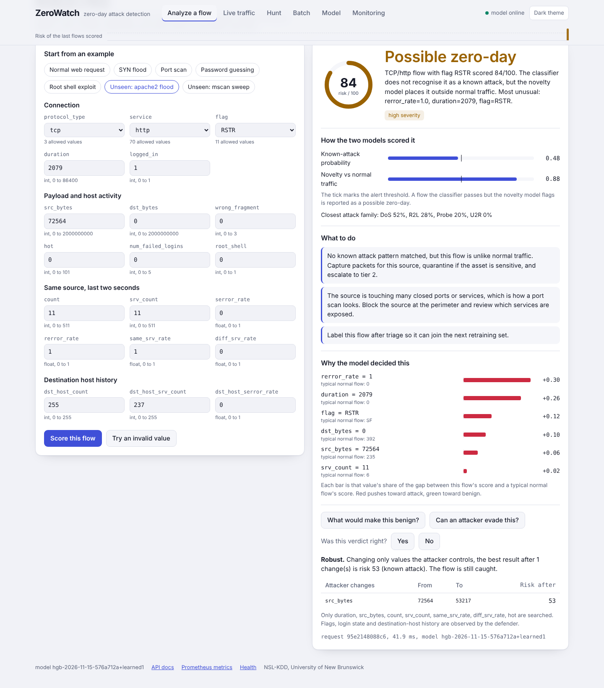 | Invalid input rejected with 422 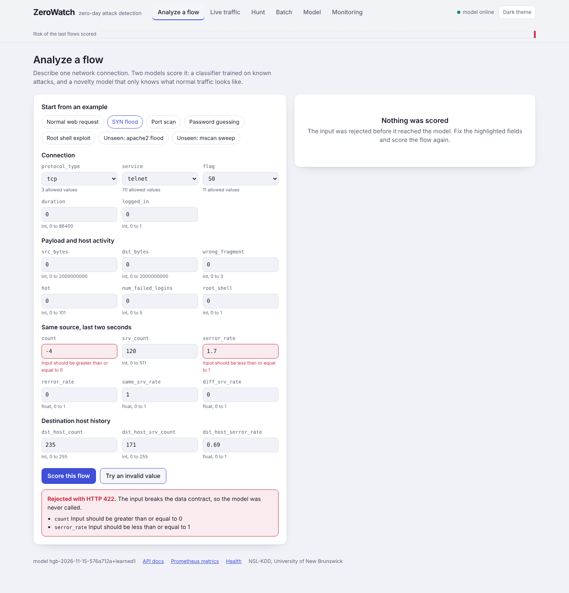 |
| Live replay 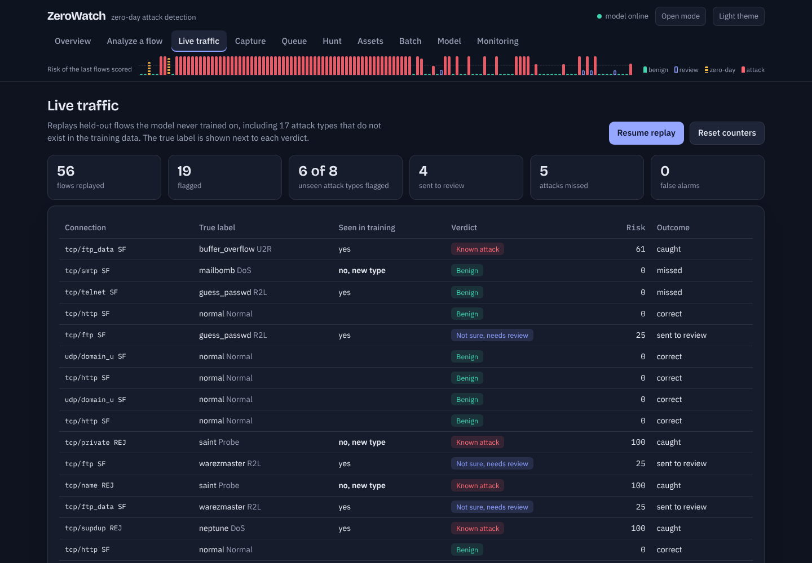 | Model tab 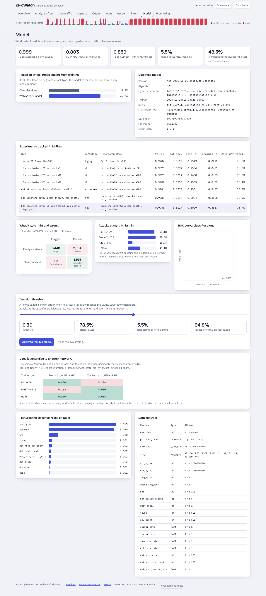 |
| Monitoring and drift 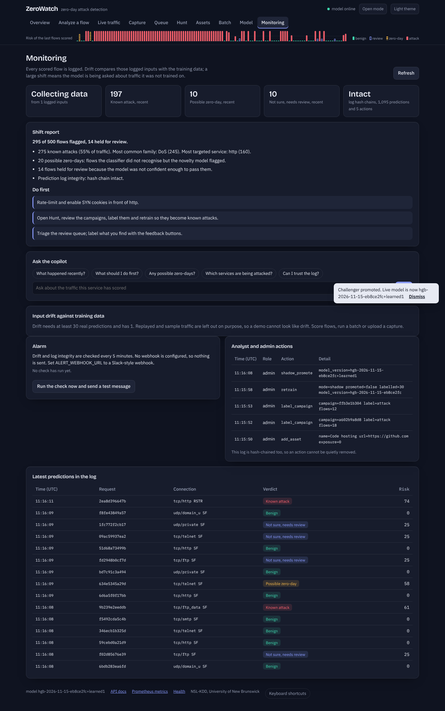 | `/docs`  |
| Hunt: campaigns and generated rules 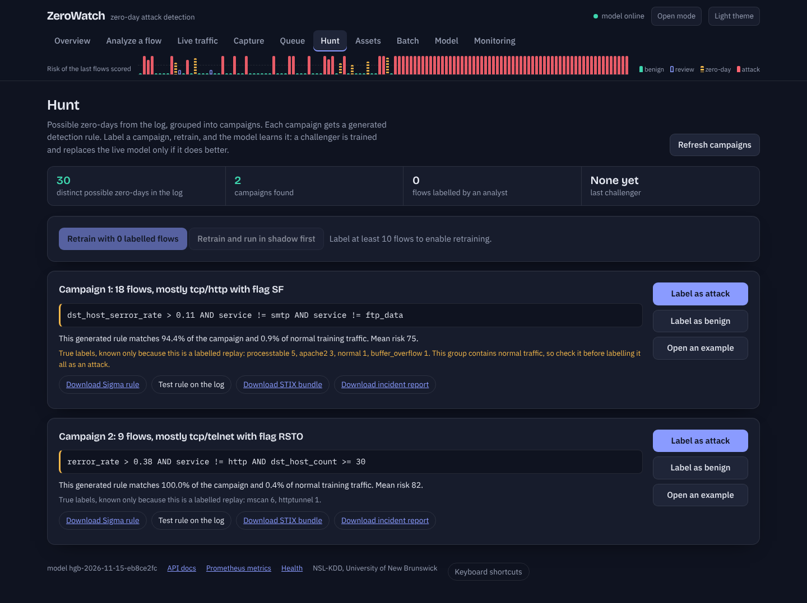 | Assets 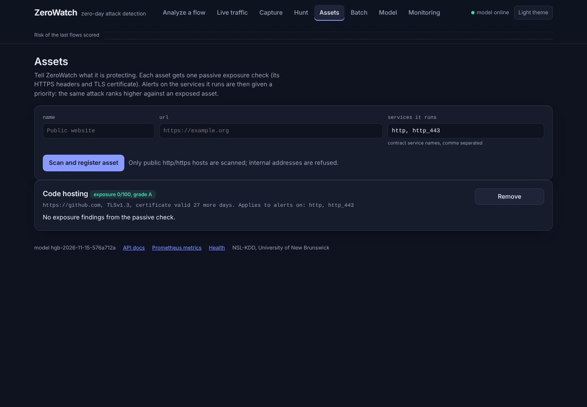 |
| Overview 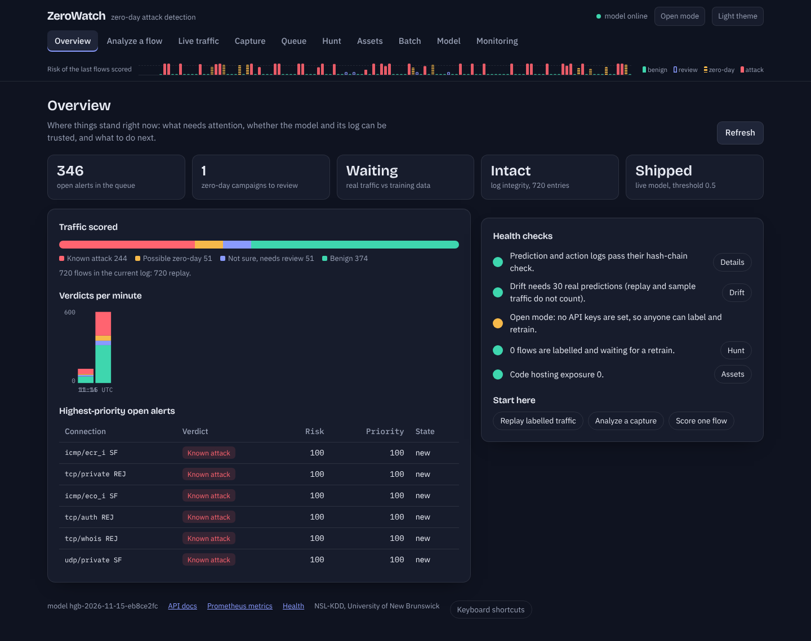 | Alert queue 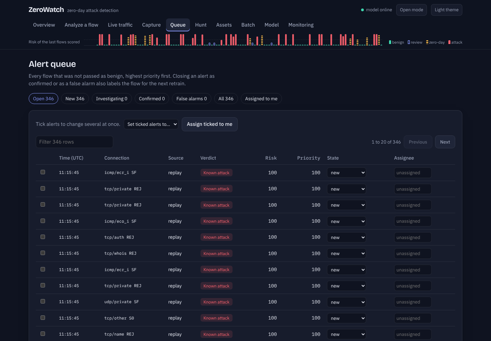 |

Still to add before submission (they need your own machine and GitHub): `docs/screenshots/mlflow-ui.png`,
`docs/screenshots/pytest.png`, `docs/screenshots/ci-green.png`.

## Limitations

- NSL-KDD is a 1999-era benchmark. The features are flow summaries, not packets, and modern traffic (TLS,
  HTTP/2, cloud services) is not represented.
- Content-based attacks (R2L such as password guessing, `snmpguess`) look like normal flows in these 20
  features and are often missed by both models.
- The novelty model's 5% false-positive budget is too high for a real SOC without a second triage stage.
- Promoted models are saved under `logs/models/`. On Render's free tier that disk is wiped on every deploy,
  so a learned model survives restarts but not redeploys; a persistent disk or object storage would fix that.
- State (labels, alert states, assets) is kept in JSON files and one process. Two instances would not share it.
- Campaigns from a small log can mix attack and normal flows, and their rules then match too much normal
  traffic. The UI shows the rule's false-match rate so this is visible before labelling.
- The conformal guarantee assumes live traffic resembles validation traffic. On shifted traffic such as
  KDDTest+ it is a useful review queue, not a guarantee.
- Flows built from packets have no session-content features (failed logins, root shell), and `logged_in` is
  approximated, so content-based attacks are invisible in captures. The bundled capture is synthetic.
- The copilot's LLM path is tested against a stub server, not a real model.
- Drift is checked on inputs only. There are no live labels, so accuracy decay is inferred, not measured.

## Team

| Member | Roll No. | Contribution |
|---|---|---|
| Bhavishyata Yadav | 24CSU036 | _fill in_ |
| Bhavya Jain | 24CSU037 | _fill in_ |
| Rudra Kumar Sharma | 24CSU175 | _fill in_ |

---

## Extended platform (local only)

`backend/`, `frontend/` and `ml/` hold the larger ZeroWatch platform that runs on localhost: a Next.js console,
a web recon engine (TLS, headers, cookies, CVE lookup, subdomains) with reports written by a local LLM through
Ollama, and a PyTorch autoencoder with leave-one-attack-family-out evaluation. It is not part of the graded
pipeline above and is not deployed.

### Tech stack

| Layer | Technology |
|---|---|
| Frontend | Next.js 14 (App Router) + TypeScript, Tailwind, shadcn/ui, Recharts |
| Backend | FastAPI (Python 3.11+), WebSockets |
| ML | PyTorch (Autoencoder), scikit-learn (Isolation Forest, Random Forest), SHAP |
| LLM | Ollama, running Llama 3.1 8B (or Mistral 7B on lower-spec machines) |
| Database | SQLite |
| External APIs (free tier) | NVD CVE API, crt.sh, VirusTotal free tier |

### Deep-model training

The actual model training and evaluation lives in [`ml/notebooks/ZeroWatch_Model_Training.ipynb`](ml/notebooks/ZeroWatch_Model_Training.ipynb) — built to run directly in **Google Colab** with no manual dataset upload. It trains the Autoencoder, Isolation Forest, and Random Forest baseline, runs the leave-one-attack-out zero-day evaluation, and generates SHAP explanations. See [`ml/README.md`](ml/README.md) for details.

### Run the platform

```bash
# 1. Start the local LLM
ollama serve
ollama pull llama3.1:8b

# 2. Start the backend
cd backend
pip install -r requirements.txt
uvicorn main:app --reload --port 8000

# 3. Start the frontend
cd frontend
npm install
npm run dev
```

Open `http://localhost:3000`.

Full setup, environment variables, and troubleshooting: see [`docs/ENVIRONMENT.md`](docs/ENVIRONMENT.md) and [`docs/DEPLOYMENT.md`](docs/DEPLOYMENT.md).


## Documentation index

| Document | Contents |
|---|---|
| [PRD.md](docs/PRD.md) | Full product requirements and features |
| [ARCHITECTURE.md](docs/ARCHITECTURE.md) | System design, data flow, services |
| [UI_UX_SPEC.md](docs/UI_UX_SPEC.md) | Screens, layout, components, design system |
| [DATABASE_SCHEMA.md](docs/DATABASE_SCHEMA.md) | Tables, relationships, indexes |
| [API_SPEC.md](docs/API_SPEC.md) | Endpoints, request/response formats |
| [SECURITY.md](docs/SECURITY.md) | Auth, encryption, validation, threat model |
| [TECH_STACK.md](docs/TECH_STACK.md) | Exact frameworks, versions, libraries |
| [USER_FLOWS.md](docs/USER_FLOWS.md) | Step-by-step user journeys |
| [FEATURES.md](docs/FEATURES.md) | Feature-by-feature behavior spec |
| [ENVIRONMENT.md](docs/ENVIRONMENT.md) | .env variables, local service setup |
| [TESTING.md](docs/TESTING.md) | Unit, integration, E2E, security testing |
| [DEPLOYMENT.md](docs/DEPLOYMENT.md) | Local run, Docker, CI/CD |
| [CHANGELOG.md](docs/CHANGELOG.md) | Development history |
| [TODO.md](docs/TODO.md) | Remaining work, known issues |


## License

MIT
